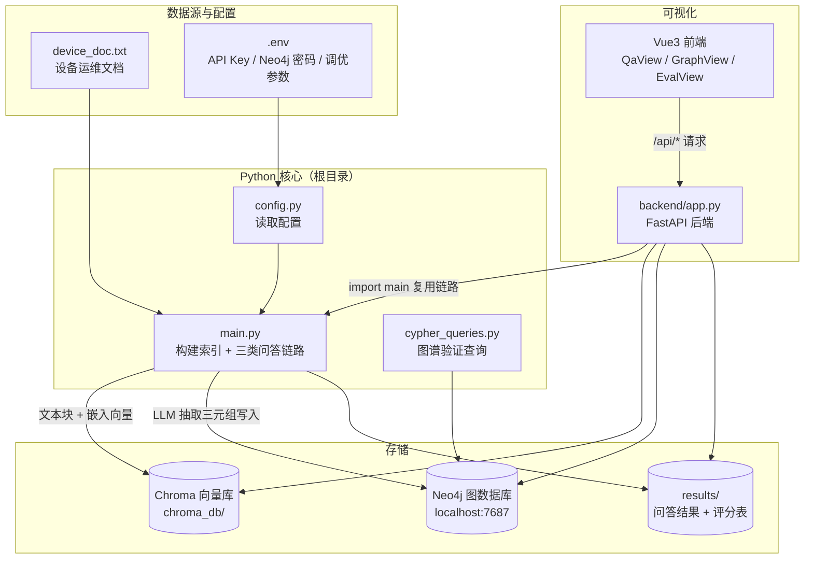
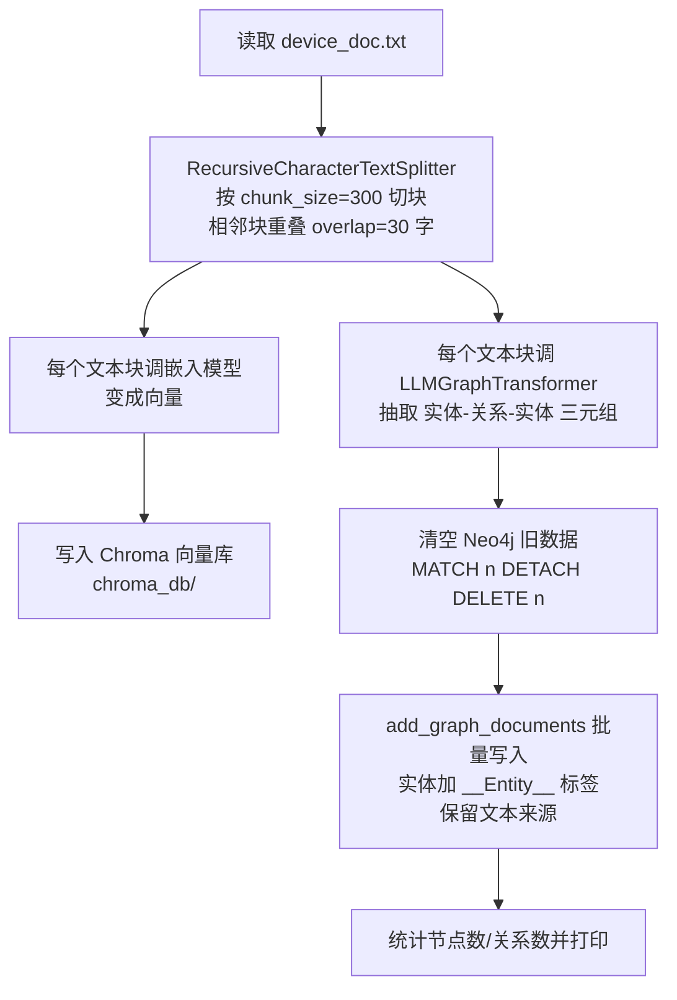
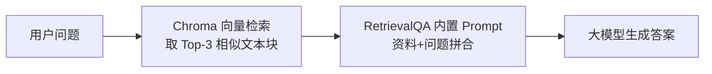
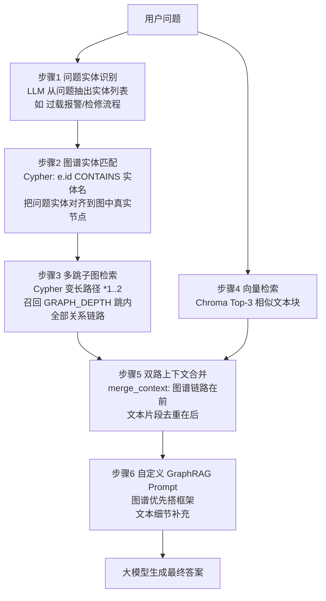
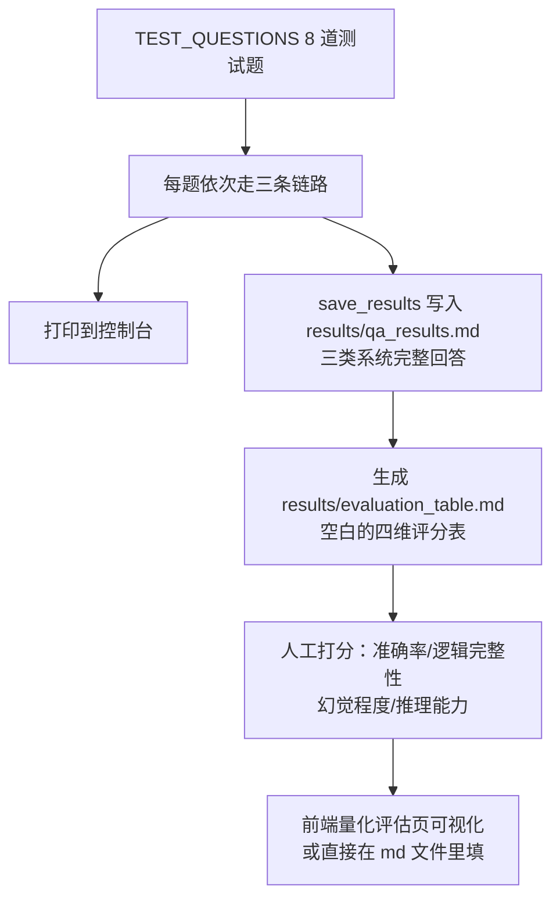
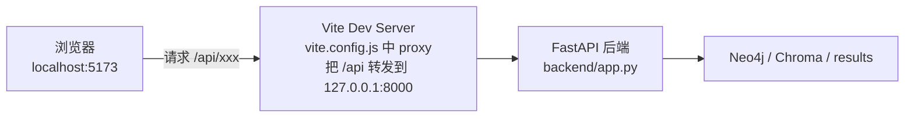

# 基于 LangChain + Neo4j 的知识图谱 RAG 设备运维问答系统 —— 项目教程

> 本文档带你从"什么是 RAG"开始，一步步理解本项目的整体架构、每个文件的作用、核心代码的执行流程。读完本文档，你应当能够独立运行、修改并讲解本项目。

---

## 目录

1. [项目是做什么的？](#1-项目是做什么的)
2. [预备知识：5 个核心概念](#2-预备知识5-个核心概念)
3. [项目整体架构](#3-项目整体架构)
4. [目录结构与每个文件的作用](#4-目录结构与每个文件的作用)
5. [核心流程详解（含流程图）](#5-核心流程详解含流程图)
6. [逐文件代码精讲](#6-逐文件代码精讲)
7. [前端可视化部分详解](#7-前端可视化部分详解)
8. [如何运行本项目](#8-如何运行本项目)
9. [常见问题与排错](#9-常见问题与排错)
10. [学习路线建议](#10-学习路线建议)
11. [实验指导书（PDF）与代码逐项对照](#11-实验指导书pdf与代码逐项对照)
12. [拓展思考的可运行实现（指导书第十一节）](#12-拓展思考的可运行实现指导书第十一节)

---

## 1. 项目是做什么的？

本项目实现了一个**设备运维领域专家问答系统**，并对**三种不同的问答方案**做对照实验：

| 方案 | 说明 | 类比 |
|---|---|---|
| ① 纯大模型问答 | 直接把问题丢给大模型，不提供任何资料 | 开卷考试但老师什么书都没给你 |
| ② 传统文本 RAG | 把文档切块、向量化，检索最相似的几段给大模型参考 | 老师随机塞给你几页相关的书页 |
| ③ 图谱增强 RAG（GraphRAG） | 在 ② 的基础上，再加上"知识图谱"提供的实体关系链路 | 老师还递给你一张知识关系导图 |

**实验假设**：③ 号方案可能更适合"多实体关联、故障溯源、链路推理"类问题，因为知识图谱显式记录实体及关系，向量检索则按文本语义召回片段。实际哪种方案表现更好，应以本项目运行结果和人工评分为准，不能仅凭架构预先断定。

### 为什么选"设备运维"领域？

设备运维场景的问答天然依赖**多级关联推理**，例如：

```
设备过载报警会触发哪些保护机制？对应的检修流程是什么？
```

回答这类问题需要串起设备、故障、保护机制、处理方式等多个实体。图谱能显式表示这些关系，但最终效果也取决于源文档是否包含相关知识，以及抽取和检索是否成功。

---

## 2. 预备知识：5 个核心概念

### 2.1 RAG（Retrieval-Augmented Generation，检索增强生成）

大模型有两大缺陷：**知识有截止日期**、**不了解私有资料**（如你公司的设备手册）。RAG 的思路是：

```
用户提问 → 先去知识库里"检索"相关资料 → 把资料和问题一起塞进 Prompt → 大模型据此作答
```

这样大模型是"看着资料答题"，幻觉（胡编乱造）会大幅减少。

### 2.2 文本嵌入与向量数据库

- **嵌入（Embedding）模型**：把一段文字变成一串数字（向量），语义相近的文字，向量距离也相近。
- **向量数据库**（本项目用 **Chroma**）：存放这些向量，支持"找出与问题向量最相似的 Top-K 段文本"，这就是 RAG 的检索环节。

### 2.3 知识图谱与 Neo4j

- **知识图谱**：用「节点（实体）— 边（关系）— 节点」的三元组形式存储知识，例如：

```
(过载报警)-[:触发]->(一级保护)-[:动作]->(降低主轴转速)
(轴承磨损)-[:导致]->(异响故障)-[:处理方式]->(更换轴承)
```

- **Neo4j**：一个原生图数据库，专门用来存储和查询这种节点/边结构，查询语言叫 **Cypher**。

### 2.4 LangChain

一个 Python 框架，把 LLM 应用开发中的常用环节（读文档、切块、调模型、检索、组织 Prompt）封装成可组合的"积木"，本项目所有链路都用它编排。

### 2.5 LLMGraphTransformer

LangChain 提供的工具：调用大模型，从一段文本中自动抽取「实体-关系-实体」三元组，然后可直接写入 Neo4j。这是本项目"文本 → 图谱"自动化的关键。

---

## 3. 项目整体架构

### 3.1 系统架构图



### 3.2 两大阶段

整个系统分为两个阶段（这是理解本项目的关键）：

| 阶段 | 做什么 | 代码位置 | 执行次数 |
|---|---|---|---|
| **索引构建** | 读文档 → 切块 → 向量入库 Chroma；LLM 抽三元组 → 写入 Neo4j | `main.py` 的 `build_vector_rag()` / `build_neo4j_graph()` | 首次运行一次（或改参数后重建） |
| **问答推理** | 三类问答链路回答测试问题，输出结果与评分表 | `main.py` 的 `run_benchmark()` 等 | 每次运行 / 每次提问 |

> `--skip-build` 只跳过索引重建；仍会重新运行 8 道题，并覆盖 `results/qa_results.md` 和 `results/evaluation_table.md`。评分表中的人工评分会被重置，运行前请先备份需要保留的评分文件。

---

## 4. 目录结构与每个文件的作用

```
LangChain-Neo4j GraphRAG QA/
│
├── config.py               # ★ 配置中心：读 .env，定义模型名/Neo4j连接/切块参数等
├── main.py                 # ★★ 全部核心业务：索引构建 + 三类问答 + 评分输出
├── cypher_queries.py       # ★ Neo4j 图谱验证：8 条 Cypher 查询（实验证据截图用）
├── experiment_extension.py # ★ 拓展实验：约束抽取/多跳溯源/场景对照/降噪融合（见第 12 章）
│
├── device_doc.txt          # 知识源：设备运维手册（唯一的知识输入）
├── requirements.txt        # Python 依赖清单
├── .env.example            # 环境变量模板（复制为 .env 后填写真实值）
├── .env                    # 你的私密配置（不提交 git）
├── README.md               # 项目简介与快速开始
├── 项目教程.md             # 项目原理、代码结构与运行说明
├── 复现指南.md             # 从创建目录开始的逐步复现说明
├── 分工.md                 # 小组工作分工参考
│
├── chroma_db/              # 【运行时自动生成】Chroma 向量库的本地持久化目录
├── results/                # 【运行时自动生成/覆盖】问答、评分及拓展实验结果
│
├── backend/
│   ├── __init__.py         # 使 backend 成为 Python 包
│   └── app.py              # ★ FastAPI 后端：给前端提供 /api/* 接口，复用 main.py
│
├── frontend/               # Vue3 + Element Plus + ECharts 可视化界面
│   ├── index.html          # 页面入口 HTML
│   ├── package.json        # npm 依赖清单（vue / element-plus / echarts / vite）
│   ├── package-lock.json   # npm 依赖锁定文件（用于 npm ci）
│   ├── vite.config.js      # Vite 配置：/api 请求代理到 127.0.0.1:8000 后端
│   ├── dist/               # 【运行 npm run build 后生成】前端构建产物
│   ├── node_modules/       # 【npm ci 后生成】依赖包
│   └── src/
│       ├── main.js         # 前端入口：创建 Vue 应用并挂载 Element Plus
│       ├── App.vue         # 根组件：左侧菜单 + 三页切换 + 侧栏统计信息
│       ├── api.js          # 后端接口封装（fetch 包装成 5 个函数）
│       └── views/
│           ├── QaView.vue      # 页面1 问答对照：三类答案逐个显示 + 证据与评分
│           ├── GraphView.vue   # 页面2 知识图谱：ECharts 力导向图可视化
│           └── EvalView.vue    # 页面3 量化评估：表格打分 + 雷达图/柱状图
│
```

> 标 ★ 的是建议精读的文件。`chroma_db/`、`results/`、`frontend/node_modules/` 和 `frontend/dist/` 属于运行或构建生成内容，通常由 `.gitignore` 排除，不需要手工创建。

---

## 5. 核心流程详解（含流程图）

### 5.1 索引构建流程（`python main.py` 首次运行时）



两个值得注意的细节：

1. **切块参数影响一切**：`CHUNK_SIZE` 太大 → 检索不精准；太小 → 信息碎片化。`CHUNK_OVERLAP` 让相邻块共享一点内容，避免一句话被切断后两边都检索不到。
2. **`ignore_tool_usage=True`**：`LLMGraphTransformer` 默认依赖大模型的 function calling 能力，但很多国产/中转接口对此支持不完整，所以本项目改用纯提示词方式抽取三元组，兼容性更好。

### 5.2 三类问答的生成流程对照

**① 纯大模型**：`问题 → LLM → 答案`，就一步。

**② 传统文本 RAG**：



**③ 图谱增强 RAG（核心，重点理解）**：



**③ 在什么情况下可能比 ② 更合适？** 以需要同时查询故障、保护机制和检修流程的问题为例：

- ② 默认召回语义相似度最高的 3 个文本块，可能未覆盖问题涉及的所有关系；
- ③ 会尝试从识别并匹配到的图谱实体查询限定跳数内的关系，再与向量检索文本合并。能否找到完整链路取决于图谱抽取结果、实体匹配和源文档内容，不能保证一定覆盖每个环节。

### 5.3 对照测试与量化评估流程



四维评估标准（对应实验指导书 8.2）：

| 维度 | 打分方式 |
|---|---|
| 准确率 | 10 分制 |
| 逻辑完整性 | 10 分制 |
| 幻觉程度 | 无 / 轻微 / 严重（是否虚构关系、参数、流程） |
| 推理能力 | 强 / 一般 / 弱（多实体关联、故障溯源、链路推理） |

---

## 6. 逐文件代码精讲

### 6.1 `config.py` —— 配置中心（任务 1）

**作用**：所有可变参数集中于此，从 `.env` 文件或系统环境变量读取，代码里不硬编码任何密钥。

关键点：

```python
def _load_dotenv(path):   # 极简 .env 解析器：每行 KEY=VALUE
    ...
    if key and value:
        os.environ[key] = value   # 非空值写入环境变量
```

- 自己手写的 30 行 `.env` 加载器，避免额外依赖 `python-dotenv`；
- **`.env` 中非空的值会覆盖同名系统环境变量**；
- 当 `NO_PROXY / no_proxy` 未设置时，配置会默认写为 `*`，令请求绕过代理；如果模型服务必须通过代理访问，需在环境中显式配置代理排除规则；
- 可用 `LLM_API_KEY / LLM_API_BASE` 与 `EMBEDDING_API_KEY / EMBEDDING_API_BASE` 为聊天模型和嵌入模型分别指定凭证或地址；未单独指定时回退到通用 OpenAI 配置；
- 暴露的配置项一览：

| 配置项 | 默认值 | 含义 |
|---|---|---|
| `MODEL_NAME` | gpt-3.5-turbo | 对话/抽取用大模型 |
| `EMBEDDING_NAME` | text-embedding-ada-002 | 嵌入模型 |
| `OPENAI_API_BASE` | 空 | OpenAI 兼容接口地址（中转站填这里；也读取 `OPENAI_BASE_URL`） |
| `NEO4J_URI/USER/PASSWORD` | bolt://localhost:7687 | 图数据库连接 |
| `CHUNK_SIZE / CHUNK_OVERLAP` | 300 / 30 | 文本切块参数（任务 7 调优项） |
| `TOP_K` | 3 | 向量检索返回条数（任务 7 调优项） |
| `GRAPH_DEPTH` | 2 | 图谱检索跳数（任务 7 调优项） |
| `DOC_PATH / CHROMA_DIR / RESULTS_DIR` | 项目目录 | 三个路径 |

### 6.2 `main.py` —— 全部核心业务（任务 2~6）

这是最重要的文件，按区块拆解：

**区块 1：模型初始化**

```python
def build_llm():        # ChatOpenAI，temperature=0.1（低温=回答更稳定）
def build_embeddings()  # OpenAIEmbeddings，把文本变向量
```

**区块 2：传统文本 RAG（`build_vector_rag`，任务 2）**

```
TextLoader 加载 → RecursiveCharacterTextSplitter 切块 → Chroma 入库
→ as_retriever 检索器 → RetrievalQA 问答链
```

`RetrievalQA` 是 LangChain 的现成"检索问答链"：内部自动完成"检索 → 拼 Prompt → 调模型"，`return_source_documents=True` 让它把引用的原文块也带回来（前端展示"检索证据"靠它）。

**区块 3：Neo4j 图谱构建（`build_neo4j_graph`，任务 3，核心）**

```python
graph = Neo4jGraph(...)                        # bolt 连接封装
graph.query("MATCH (n) DETACH DELETE n")       # 清空旧图谱
transformer = LLMGraphTransformer(llm=llm, ignore_tool_usage=True)
graph_docs = transformer.convert_to_graph_documents(split_docs)  # 抽三元组
graph.add_graph_documents(graph_docs, baseEntityLabel=True, include_source=True)
```

- `baseEntityLabel=True`：给每个实体节点统一加一个 `__Entity__` 标签，之后所有查询都可以只扫实体节点（`MATCH (e:__Entity__)`），性能和准确性都更好；
- `include_source=True`：同时保存"这个三元组是从哪个文本块抽出来的"，方便溯源；
- 注意：**每个文本块都要调一次大模型**，所以首次构建较慢、较费 token。

**区块 4：混合检索（任务 4）**

| 函数 | 作用 |
|---|---|
| `extract_question_entities()` | 用 LLM 从问题中抽出实体（要求只输出 JSON 数组，正则 `\[]` 提取并解析，最多取 6 个） |
| `match_graph_nodes()` | 对每个实体用 `e.id CONTAINS $name` 模糊匹配图谱节点（容忍"过载报警"vs"过载"的表述差异） |
| `graph_retrieve()` | 核心查询：从匹配节点出发，走 `*1..{depth}` 变长路径，`UNWIND` 展开关系，返回最多 80 条 `(实体)-[:关系]->(实体)` 文本行 |
| `merge_context()` | 图谱链路放最前（`【图谱结构化关联链路】`），文本片段去重后拼在后面，合成统一上下文 |

两个工程细节：

- **变长路径长度 `*1..2` 里的数字不能用 Cypher 参数传入**，只能字符串拼接，所以代码里 `depth = int(depth)` 强制转整数防注入；
- `dict.fromkeys(lines)` 利用字典 key 去重，保持顺序。

**区块 5：三类问答（任务 5）**

```python
pure_llm_qa(llm, question)            # ① 直接 invoke
vector_rag_qa(rag_chain, question)    # ② rag_chain.invoke({"query": q})["result"]
graph_rag_qa(llm, retriever, graph, question)
    # ③ graph_retrieve 图谱检索 + retriever 向量检索
    #    merge_context 合并 → GRAPH_RAG_PROMPT | llm | StrOutputParser()
```

`GRAPH_RAG_PROMPT` 是自定义的防幻觉模板，核心指令：**"优先使用图谱结构化关联逻辑梳理答案框架，结合文本细节补充内容，无依据则如实告知，禁止虚构"**。`PROMPT | llm | parser` 是 LangChain 的 LCEL 管道语法，表示"提示词 → 模型 → 输出解析"依次串联。

**区块 6：对照测试与输出（任务 6）**

- `TEST_QUESTIONS`：8 道题，覆盖基础事实问答、故障关联推理、多实体链路查询等题型；
- `run_benchmark()`：每题跑三条链路，打印并记录；
- `save_results()`：每次运行都写出 `results/qa_results.md`（完整回答）和 `results/evaluation_table.md`（空白评分表，供人工打分）；旧的人工评分会被覆盖，包括使用 `--skip-build` 时。

**区块 7：主程序**

```python
parser.add_argument("--skip-build", ...)  # 跳过重建，只做问答
# 不带参数：重建向量库与图谱（图谱重建会清空 Neo4j 现有节点/关系）→ 跑测试
```

### 6.3 `cypher_queries.py` —— 图谱验证查询（任务 3-4）

内置 8 条 Cypher 查询（存于 `QUERIES` 列表），用途有二：

1. 复制到 **Neo4j Browser**（浏览器访问 http://localhost:7474）执行并**截图作为实验证据**；
2. 直接 `python cypher_queries.py` 自动逐条执行打印结果。

查询覆盖：查看全部节点/关系 → 按实体名检索（设备/过载/故障/维护）→ **多跳故障溯源**（`*1..2` 两层链路）→ 图谱统计。

> ⚠️ 易错点：`LLMGraphTransformer` 抽出的实体名存在 `id` 属性（不是 `name`），所以指导书里的 `e.name CONTAINS "设备"` 要写成 `e.id CONTAINS "设备"`。

### 6.4 `backend/app.py` —— FastAPI 后端

**设计原则：薄封装，复用核心问答逻辑**。它在启动时直接 `import main`，并初始化在线问答所需的模型、检索器和 Neo4j 连接。启动后不会自动构建索引；需先运行过 `python main.py` 并确保 Chroma 与 Neo4j 已有数据。它不等同于运行 `main.py --skip-build`，后者还会执行基准问答并重写结果文件：

```python
llm = main.build_llm()
vector_db = Chroma(persist_directory=CHROMA_DIR, embedding_function=embeddings)
retriever = vector_db.as_retriever(search_kwargs={"k": TOP_K})
rag_chain = RetrievalQA.from_chain_type(...)
graph = Neo4jGraph(...)
graph_chain = main.GRAPH_RAG_PROMPT | llm | StrOutputParser()
```

提供以下 REST 接口：

| 接口 | 方法 | 作用 |
|---|---|---|
| `/api/stats` | GET | 图谱节点数/关系数、模型与参数信息（前端侧栏展示） |
| `/api/qa` | POST | 聚合接口：输入问题并返回三类系统回答 |
| `/api/qa/{mode}` | POST | 单路问答接口；前端分别调用，使每个答案完成后即可显示 |
| `/api/graph` | GET | 返回 ECharts 力导向图需要的 `{nodes, links}` 格式；`center` 为空给全图，指定则给 N 跳子图 |
| `/api/evaluation` | GET/POST | 读取 / 回写 `results/evaluation_table.md`（前端打分直接落盘为 Markdown，保证交付物格式） |

值得学习的实现细节：

- `_rows_to_graph()`：把 Neo4j 查询行转成 ECharts 格式，`category()` 会跳过 `__Entity__` 这类内部标签，取第一个真实标签作为节点分类（用于前端着色）；
- CORS 中间件允许跨域，Vite 开发服务器（5173 端口）才能调 8000 端口的后端；
- 评分表读写用正则逐行解析 Markdown 表格，Markdown 既是人看的报告也是接口的数据源。

### 6.5 根目录其他文件

| 文件 | 作用 |
|---|---|
| `device_doc.txt` | **唯一知识源**：《CK6140 立式数控车床设备运维操作手册》，共五章：设备基本组成、开机前检查作业规范、常见故障排查与处理（主轴异响/过载报警 ALM-03/精度偏差/冷却故障）、维护保养制度（日常维护/三级保养/长期停机保养）、安全操作注意事项。更换知识文档时，直接替换内容、保持文件名不变，然后重跑 `python main.py` 重建索引 |
| `.env.example` | 配置模板，复制为 `.env` 后填 API Key、Neo4j 密码 |
| `requirements.txt` | Python 依赖。比指导书多了 `langchain-experimental`（因为 `LLMGraphTransformer` 在这个包里）和 `json-repair`（修复大模型输出的不合法 JSON） |
| `复现指南.md` | 从创建项目目录开始，按文件说明和命令复现项目 |
| `项目教程.md` / `README.md` / `分工.md` | 本教程、项目快速说明、小组分工参考 |
| `.gitignore` | 指定虚拟环境、密钥、索引、结果和前端构建依赖等不纳入版本控制的文件 |

---

## 7. 前端可视化部分详解

### 7.1 前端技术栈

| 库 | 作用 |
|---|---|
| Vue 3（`<script setup>` 语法） | 前端框架 |
| Element Plus | UI 组件库（按钮、表格、卡片、菜单等），已配置中文语言包 |
| ECharts 5 | 图表库（力导向图、雷达图、柱状图） |
| Vite | 开发服务器与打包工具，5173 端口 |

### 7.2 前端与后端的交互流程



`api.js` 把接口封装成 5 个函数：`getStats` / `getGraph` / `askOne` / `getEvaluation` / `saveEvaluation`。

### 7.3 三个页面

| 页面组件 | 功能 |
|---|---|
| `QaView.vue` 问答对照 | 输入问题后分别调用 `/api/qa/{mode}`，三种模式独立运行，某个答案完成后立即显示；RAG 卡片可展开查看检索证据，并可在答案旁填写评分 |
| `GraphView.vue` 知识图谱 | 调 `/api/graph` 拿 `{nodes, links}`，用 ECharts `graph` 系列（`layout: 'force'` 力导向）渲染；支持输入中心实体 + 检索深度查子图；**点击节点**以它为中心重查；节点大小按连接度（度数越高越大） |
| `EvalView.vue` 量化评估 | 调 `/api/evaluation` 读评分表 → 表格内联编辑打分 → `saveEvaluation` 一键保存回 `evaluation_table.md`；同时按四维分数渲染雷达图（三系统对比）和准确率柱状图 |

### 7.4 数据流转示例（以提问为例）

```
用户在 QaView 输入问题
  → api.js askOne() 分别发起三次 POST /api/qa/{mode}
  → Vite 代理 → FastAPI 对应单路问答处理函数
  → 调用纯大模型 / 文本 RAG / 图谱增强 RAG 链路
  → 每条请求单独返回答案与可用证据
  → QaView 按各自请求完成状态逐张更新答案卡片
```

---

## 8. 如何运行本项目

### 8.1 准备环境

1. **Python 3.10 或 3.11**，安装项目依赖及后端运行依赖：
   ```bash
   pip install -r requirements.txt fastapi uvicorn
   ```
2. **Neo4j Desktop**：安装后创建本地数据库并 Start（默认 `bolt://localhost:7687`），记下密码。
3. **配置密钥**：复制 `.env.example` 为 `.env`，填入：
   - `OPENAI_API_KEY`：默认模型密钥；聊天模型和嵌入模型也可分别配置 `LLM_API_KEY`、`EMBEDDING_API_KEY`
   - `OPENAI_API_BASE`：通用接口地址（用官方接口可留空）；也可分别设置 `LLM_API_BASE`、`EMBEDDING_API_BASE`
   - `NEO4J_PASSWORD`：Neo4j 密码
   - `MODEL_NAME` / `EMBEDDING_NAME`：按你使用的接口填

### 8.2 命令行实验模式

```bash
python main.py              # 重建向量库与 Neo4j 图谱，再跑三类问答对照测试
python main.py --skip-build # 复用已有索引，只跑问答；仍会覆盖两份结果文件和评分表
python cypher_queries.py    # 图谱验证查询（配合 Neo4j Browser 截图）
```

完整构建会清空 Neo4j 当前数据库中的节点和关系；请使用专用实验库。两种运行方式都会重写 `results/qa_results.md` 和 `results/evaluation_table.md`，如需保留人工评分请先备份评分表。运行后到 `results/` 查看结果。

### 8.3 可视化模式（两个终端）

```bash
# 终端 1：后端（要求已先跑过一次 python main.py，索引已存在）
uvicorn backend.app:app --port 8000

# 终端 2：前端（首次安装锁定的依赖）
cd frontend
npm ci
npm run dev
```

浏览器打开 http://localhost:5173 ，依次体验问答对照、知识图谱、量化评估三个页面。

### 8.4 修改知识库文档怎么办？

1. 用新内容替换 `device_doc.txt`（保持文件名不变）；
2. **必须删除 `chroma_db/` 目录**（或直接不带 `--skip-build` 重跑 `python main.py`），并重建图谱；
3. 注意：修改 `CHUNK_SIZE / CHUNK_OVERLAP` 等切块参数后同样必须重建向量库，不能用 `--skip-build`。

---

## 9. 常见问题与排错

| 现象 | 原因与解决 |
|---|---|
| `LLMGraphTransformer` 报错或抽不出三元组 | 它依赖模型的 function calling/结构化输出能力；本实现已用 `ignore_tool_usage=True` 规避大部分问题，仍失败则检查接口是否正常、模型是否支持 |
| Neo4j 连接失败 | 确认 Neo4j Desktop 中数据库已 Start；`.env` 中 URI/账号/密码一致 |
| `ProxyError / APIConnectionError` | Windows 系统代理（Clash 等）未运行但 Python 走了代理；`config.py` 已设 `NO_PROXY=*` 直连，确认该配置未被覆盖 |
| 重跑报 Chroma 集合/维度冲突 | 删除 `chroma_db/` 后重跑 |
| 图谱节点/关系数为 0 | 实体抽取静默失败：检查模型接口返回；换一个支持工具调用的模型 |
| 前端侧栏显示"后端未连接" | uvicorn 没启动，或没先跑 `python main.py` 生成索引 |
| 图谱页面为空 | Neo4j 未启动或图谱未构建；先用 `cypher_queries.py` 确认库里有数据 |

---

## 10. 学习路线建议

按以下顺序阅读代码，事半功倍：

1. **先读实验指导书 PDF 和 `README.md`**：理解实验目标、任务要求及当前项目入口；从空目录复现可按 `复现指南.md` 操作；
2. **读 `config.py`**：10 分钟，掌握所有配置项；
3. **精读 `main.py`**：按注释的 7 个区块顺序读，配合本文第 5 节的流程图；
4. **动手跑 `python main.py`**：观察控制台输出，打开 Neo4j Browser（http://localhost:7474）看看生成的图谱长什么样，把 `cypher_queries.py` 里的语句逐条贴进去玩一玩；
5. **读 `backend/app.py`**：重点看"如何复用 main.py"和接口如何把查询结果转成前端需要的格式；
6. **读前端三个 view**：`QaView.vue` 最简单，先读它；再看 `GraphView.vue` 的 ECharts 配置；`EvalView.vue` 的雷达图映射逻辑（文字评分转 10 分制）是个不错的小例子；
7. **做实验（任务 7）**：修改 `.env` 里的 `CHUNK_SIZE / TOP_K / GRAPH_DEPTH` 后对比 `results/qa_results.md`。`TOP_K`、`GRAPH_DEPTH` 可用 `--skip-build` 复用既有索引观察问答影响；改 `CHUNK_SIZE / CHUNK_OVERLAP` 必须重建索引。每次运行会覆盖评分表，实验前先备份人工评分。

### 进阶思考题

- 为什么图谱链路要放在上下文最前面（`merge_context` 的拼接顺序）？提示：大模型对 Prompt 开头/结尾的内容更敏感。
- `match_graph_nodes` 用 `CONTAINS` 模糊匹配，可能匹配到不相关节点吗？如何改进（如向量相似度对齐实体）？
- 如果文档有 100 万字，`LLMGraphTransformer` 每块调一次大模型成本很高，有哪些优化思路（批量抽取、本地小模型、增量更新图谱）？

---

## 11. 实验指导书（PDF）与代码逐项对照

> 本章将《学期项目实验——基于知识图谱 RAG 领域专家问答系统实验指导书》的要求与本项目代码逐项核对，帮助你确认"代码做了什么、还有什么要自己完成"。

### 11.1 结论总览

**项目实现了任务 1~7 的主要代码链路、8.1 查询和评分数据支持**；实验截图、人工评分、记录表填写、结果分析和报告撰写仍需结合实际运行完成。评分与结论应以本组真实实验结果为准。

### 11.2 任务级对照表（指导书第六节）

| 指导书要求 | 现有代码实现 | 状态 |
|---|---|---|
| **任务1** 环境部署、API 环境变量、`device_doc.txt` 放根目录 | `config.py`（读 `.env`）、`.env.example`、`requirements.txt`；密钥不硬编码 | ✅ 已覆盖，且比参考代码更规范 |
| **任务2** TextLoader → 切块 → Chroma → RetrievalQA | `main.py: build_vector_rag()` 完整链路 | ✅ 一致（修复了参考代码的过时 import） |
| **任务3** GraphTransformer 抽三元组 → 清库 → 写 Neo4j → 统计节点/关系 | `main.py: build_neo4j_graph()`，含 `baseEntityLabel`、来源保留、数量统计 | ✅ 一致 |
| **任务3-4** 基础 Cypher 查询（实体关联/故障检索/运维规则） | `cypher_queries.py` 内置 8 条，覆盖 8.1 全部 3 条 + 拓展多跳 | ✅ 已覆盖 |
| **任务4** 实体识别 + 图谱关联检索 + 双路融合去重 + 自定义 Prompt | `extract_question_entities() / match_graph_nodes() / graph_retrieve() / merge_context()` + `GRAPH_RAG_PROMPT` | ✅ **比参考代码强**：参考代码的 `GraphQAChain` 实际只做图谱检索且 Prompt 变量不匹配；本项目真正实现了双路混合检索 |
| **任务5** 三类问答链路 | `pure_llm_qa / vector_rag_qa / graph_rag_qa` | ✅ 一致 |
| **任务6** 5~10 道测试题 + 记录完整输出 + 四维量化打分 | 8 道题 + `run_benchmark()` + 自动生成评分表模板；具体评分由人工完成 | ✅ 代码已实现，需运行与人工评分 |
| **任务7** 调优切块/TopK/检索深度 | `CHUNK_SIZE / CHUNK_OVERLAP / TOP_K / GRAPH_DEPTH` 可配置；切块参数变化需重建，检索参数可复用索引重跑 | ✅ 有调参入口，需自行完成对比实验 |

### 11.3 指导书修正项

1. **8.1-3 属性名差异**：指导书 `e.name CONTAINS "设备"` → 实际实体名在 `id` 属性，代码已改为 `e.id CONTAINS "设备"`（`cypher_queries.py` 注释里有说明）；
2. **关系计数**：指导书参考代码 `MATCH ()-[r]-()` 每条关系数两遍 → 代码用有向 `MATCH ()-[r]->()`；
3. **依赖缺失**：指导书安装命令漏了 `langchain-experimental`（`LLMGraphTransformer` 所在包）→ `requirements.txt` 已补；
4. **兼容性**：`LLMGraphTransformer` 加了 `ignore_tool_usage=True`（很多国产/中转接口不支持 function calling，参考代码默认模式会解析失败）。

### 11.4 超出指导书的部分

- **FastAPI 后端 + Vue3 前端**（`backend/app.py`、`frontend/`）：指导书没要求，实现了问答对照可视化、ECharts 图谱可视化、在线打分回写评分表；
- **拓展思考全部实现**：指导书第十一节 4 个选做拓展已编写为 `experiment_extension.py`（详见第 12 章）；
- 本文档第 3、5 节的架构图与流程图，可直接用于实验报告的"系统架构"章节。

### 11.5 尚需人工完成的部分（代码无法代劳）

对照指导书第十节"实验交付要求"：

| 指导书交付要求 | 待办 |
|---|---|
| 8.1 查询截图 | 运行 `python cypher_queries.py` + 在 Neo4j Browser 执行同款语句并截图 |
| 10.2-4 三类问答结果截图 | 跑 `python main.py`，截控制台输出或前端问答对照页 |
| 10.2-4 量化评分表 | 在 `results/evaluation_table.md` 或前端"量化评估"页人工打分 |
| 10.2-5/6 对比分析与问题反思 | 需基于实际跑出的结果撰写（幻觉抑制、逻辑完整性提升的原因；图谱抽取误差、检索冗余等） |
| 任务7 调优实验 | 改 `.env` 参数重建后对比效果，记录结论（参考本文档第 10 节学习路线第 7 步） |

---

## 12. 拓展思考的可运行实现（指导书第十一节）

指导书"十一、实验拓展思考（选做）"的 4 个问题已全部实现为可运行的实验脚本 `experiment_extension.py`，每个拓展自动生成 Markdown 报告到 `results/extension_task*.md`，可直接作为实验报告素材。

### 12.1 运行方式

```bash
python experiment_extension.py            # 依次运行拓展 1~4
python experiment_extension.py --only 2   # 只运行某个拓展（1/2/3/4）
python experiment_extension.py --depth-max 3 --alpha 0.6   # 拓展2/4 的参数
python experiment_extension.py --question "设备过载报警会触发哪些保护机制？对应的检修流程是什么？"
```

前置条件：拓展 1 只需大模型接口；拓展 2/3/4 需先运行过 `python main.py`（`chroma_db/` 与 Neo4j 图谱已存在）。

### 12.2 拓展 1：自定义实体/关系约束优化三元组抽取

- **做法**：用 `LLMGraphTransformer` 的 `allowed_nodes`（限定 9 类实体：设备/部件/故障/报警/保护机制/运行参数/维护项目/操作/角色）和 `allowed_relationships`（限定 11 类运维语义关系：组成/导致/触发/联动/处理方式/排查步骤/维护周期/执行角色/包含/参数为/检查项目），与无约束模式各抽取一轮；
- **关键设计**：两轮都只在**内存中**统计 GraphDocument，不写入 Neo4j——避免覆盖主图谱，也省去二次建库；
- **质量指标**：节点数、关系类型数、**领域关键词命中率**（30 个设备运维关键词白名单，命中率越高说明"文档/章节"类噪声实体越少）；
- **输出**：`results/extension_task1_constraints.md` 含对比表、关系类型清单、节点样例与结论分析。

### 12.3 拓展 2：多跳 Cypher 故障溯源

- **做法**：对同一问题（默认"过载报警→保护机制→检修流程"）先做实体识别与图谱匹配，再分别以 depth=1/2/3 执行多跳 Cypher，统计每个深度的链路数、涉及实体数、关系类型数，并输出完整链路明细；
- **输出**：`results/extension_task2_multihop.md`；
- **分析提示**：比较不同 depth 下召回链路数量、实体数和实际相关性；深度增加通常会扩大召回范围，也可能引入更多无关链路。结论应根据运行数据填写。

### 12.4 拓展 3：简单问答 vs 复杂推理场景对照

- **做法**：设计两组题型——`SIMPLE_QUESTIONS`（额定电压、润滑油型号等单事实题）与 `COMPLEX_QUESTIONS`（多实体链路推理题），每组分别用传统文本 RAG 与 GraphRAG 回答并记录耗时；
- **输出**：`results/extension_task3_scenarios.md`，含逐题并排回答、命中实体、耗时对比与结论分析；
- **分析提示**：对比简单题与复杂题的回答质量、耗时、检索证据覆盖情况；不要预设 GraphRAG 必然优于文本 RAG，需结合本地模型、知识图谱质量和真实评分讨论。

### 12.5 拓展 4：检索降噪 + 向量-图谱权重融合

两个轻量级算法实现（核心函数可直接搬进自己的项目）：

1. **图谱链路降噪 `denoise_graph_links()`**：从命中实体（种子）出发，迭代保留连通边构成连通子图——多跳链路完整保留，而 Cypher `LIMIT` 截断与 `CONTAINS` 模糊匹配带进的孤立噪声边被过滤；
2. **融合重排 `rerank_docs()`**：对向量召回的文本块计算 `final = α·向量名次分 + (1-α)·图谱实体命中分`（α 可用 `--alpha` 调整），让"既语义相似又提到命中实体"的片段排到最前，等价于向量-图谱证据交叉验证。

- **输出**：`results/extension_task4_denoise_fusion.md`，含降噪前后链路对比、重排前后文本块顺序与得分明细；
- **进阶方向**（报告"问题与反思"可引用）：图谱社区划分（Leiden 算法 + 社区摘要，参考微软 GraphRAG）、RRF 倒数排名融合、按关系类型加权的边重要性评分、检索后 LLM 重排。

### 12.6 拓展实验与报告章节的对应关系

| 指导书拓展思考 | 代码 | 报告输出 |
|---|---|---|
| 拓展思考-1 约束优化抽取 | `ext1_constrained_extraction()` | `results/extension_task1_constraints.md` |
| 拓展思考-2 多跳溯源 | `ext2_multi_hop()` | `results/extension_task2_multihop.md` |
| 拓展思考-3 场景适配差异 | `ext3_simple_vs_complex()` | `results/extension_task3_scenarios.md` |
| 拓展思考-4 优化方案 | `ext4_denoise_fusion()`（降噪+融合已实现，社区划分等给出方向） | `results/extension_task4_denoise_fusion.md` |

---

## 附：与实验指导书参考代码的 5 处差异（README 同款总结）

1. **依赖补全**：补上 `langchain-experimental`（`LLMGraphTransformer` 所在包）；
2. **真正实现任务 4 的混合检索**：参考代码只用 `GraphQAChain`（仅图谱检索且 Prompt 变量不匹配），本实现显式编排"实体识别 → 双路检索 → 去重合并 → 自定义 Prompt"；
3. **Cypher 属性名**：实体名在 `id` 属性而非 `name`，8.1 的查询已相应修正；
4. **关系计数**：用有向 `MATCH ()-[r]->()` 避免无向匹配把每条关系数两遍；
5. **接口兼容**：`base_url` 显式传入兼容各类 OpenAI 兼容中转接口，密钥一律走环境变量，不硬编码。
